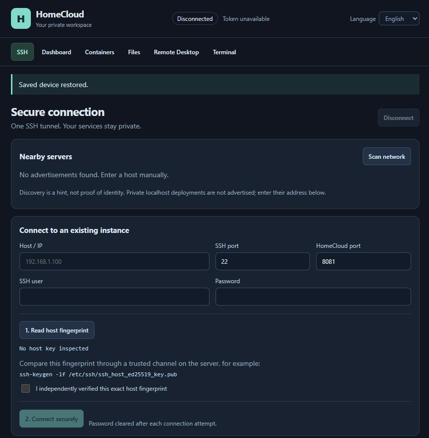
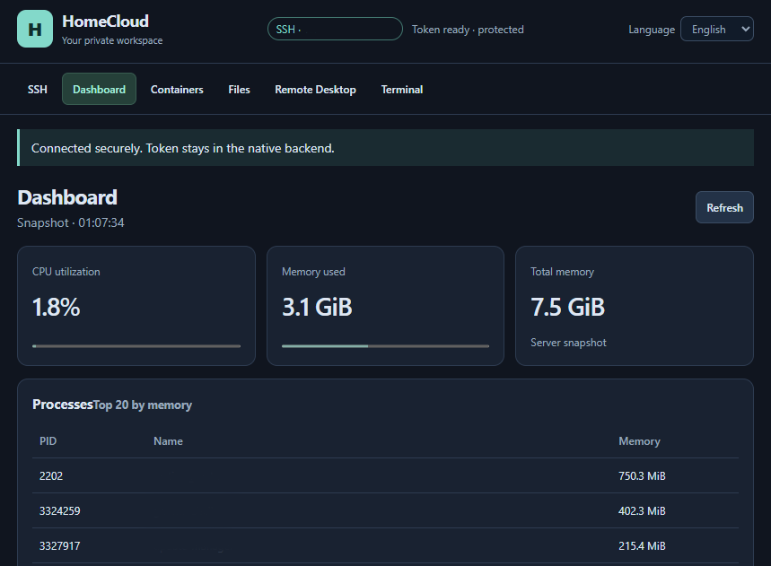
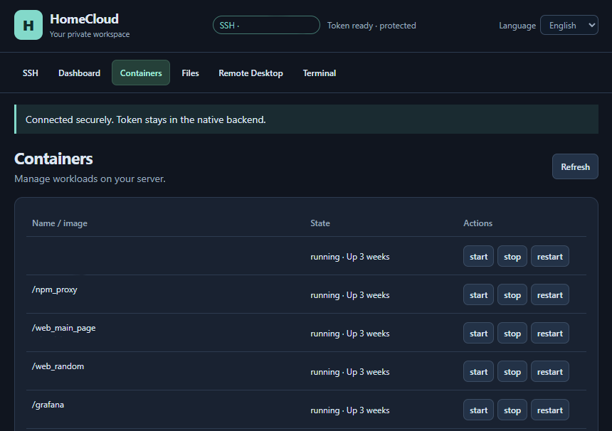
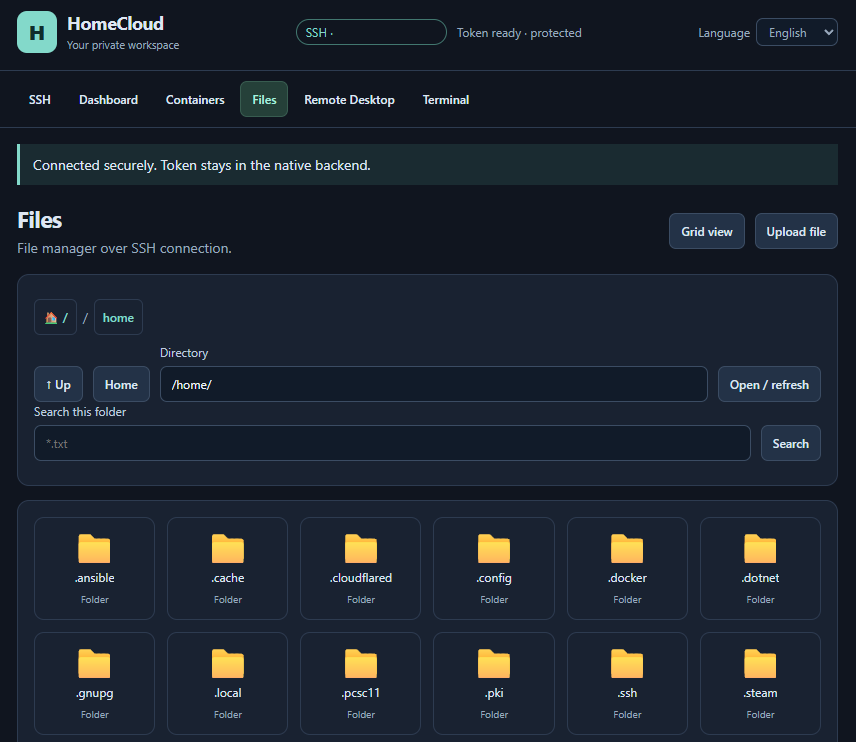
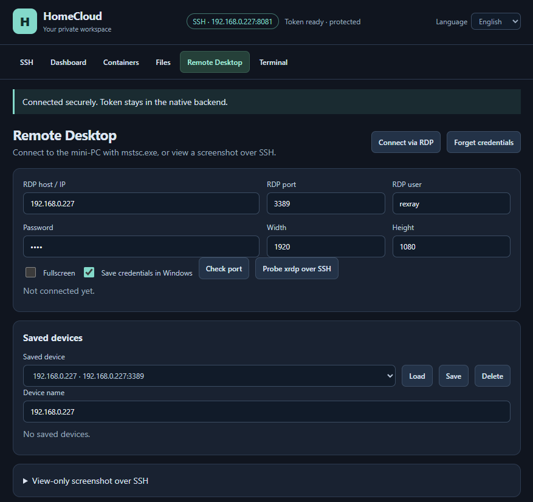
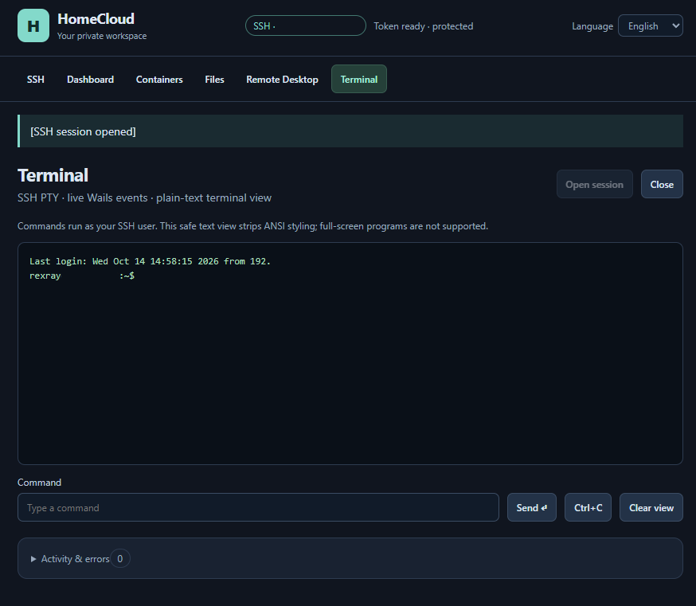
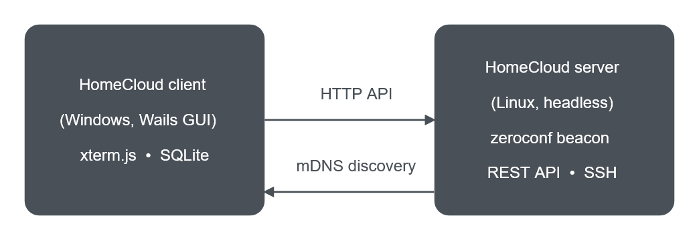

# HomeCloud

A self-hosted home server you control from a Windows desktop app.

HomeCloud is two parts that talk over your local network:

- **Server** — a small headless Go binary for a Linux box (mini-PC, NAS,
  Raspberry Pi). It exposes a REST API over HTTP and announces itself on the LAN
  via mDNS.
- **Client** — a native Windows desktop app (Wails) that discovers servers
  automatically and then lets you manage them: live system stats, Docker
  containers, an SSH file manager, a remote desktop view and a full SSH
  terminal.

No cloud account, no telemetry — everything stays on your machines.

<p align="center">
  
</p>

## Screenshots

| Dashboard | Containers |
|:---------:|:----------:|
|  |  |

| Files over SSH | Remote Desktop |
|:--------------:|:--------------:|
|  |  |

<p align="center">
  
</p>

## Features

- **Automatic discovery** — finds HomeCloud servers on the LAN over mDNS
  (`_homecloud._tcp`); no manual IP entry required.
- **Host key verification** — reads and shows the server's SSH host fingerprint
  before you connect, so you can compare it over a trusted channel.
- **Dashboard** — live CPU and memory usage plus the top processes on the
  server.
- **Containers** — list Docker workloads and stop / restart them (with
  confirmation) straight from the desktop.
- **Files over SSH** — browse, upload and download files through the SSH
  connection.
- **Remote Desktop** — open the mini-PC in `mstsc.exe`, or view a read-only
  screenshot captured over SSH.
- **SSH terminal** — a full terminal emulator (xterm.js) embedded in the app.
- **Local, encrypted storage** — saved devices and credentials live in a local
  SQLite database; passwords are encrypted with Windows DPAPI.

## Architecture



- The **server** registers itself with
  `zeroconf.Register("homecloud", "_homecloud._tcp", ...)` and serves the REST
  API on `:8080` by default:
  - `GET  /api/v1/health` — health check
  - `GET  /api/v1/stats` — CPU / memory snapshot
  - `GET  /api/v1/processes` — top processes
  - `GET  /api/v1/containers` — Docker container list
  - `POST /api/v1/containers/control` — stop / restart a container
- The **client** discovers servers over mDNS and talks to the chosen one over
  HTTP.

## Requirements

**To run the client:** Windows 10/11 (64-bit). Nothing else — the embedded
server binary is bundled inside the exe.

**To build from source:**

- [Go](https://go.dev/dl/) 1.23+
- Windows with the [Wails](https://wails.io/) toolchain (WebView2 runtime)
- PowerShell 5+ (for `build.ps1`)

## Getting started

### 1. Download the client

Grab `HomeCloud-<version>-win64.zip` from the
[Releases](https://github.com/rexrayyy/homecloud/releases) page, unpack it and
run `HomeCloud.exe`. No installation required.

### 2. Run a server

On your Linux host, start the server binary:

```bash
./homecloud -mode server -addr :8080
```

It keeps running in the foreground and announces itself on the LAN.

### 3. Connect

Open `HomeCloud.exe`. Servers on your network appear under **Nearby servers**;
pick one, verify the host fingerprint, then connect.

## Building from source

From the repository root:

```powershell
.\build.ps1
```

This cross-compiles the server for `linux/amd64`, embeds it into the client
(`//go:embed`) and produces a Windows GUI build (`-H=windowsgui`) as
`homecloud.exe`.

> The embedded server (`internal/client/payload/homecloud-linux-amd64`) is a
> build artifact and is **not committed** — run `build.ps1` once before the
> first build of a fresh clone.

Run the tests and static checks:

```powershell
go test ./...
go vet ./...
```

## Releasing

`homecloud.exe` is a ~43 MB artifact and is deliberately kept out of git; ship
it as a GitHub Release asset instead:

```powershell
.\package-release.ps1 -Version 1.0.0
# -> dist\HomeCloud-1.0.0-win64.zip
```

Then create a release on GitHub and attach that zip.

## Where your data lives

The client keeps everything in your user profile, never next to the exe:

| What | Where |
|------|-------|
| Saved devices + encrypted credentials | `%LOCALAPPDATA%\HomeCloud\client.db` (SQLite) |
| Passwords | Encrypted with Windows DPAPI (per-user key) |

Override the database location with the `HOMECLOUD_CLIENT_DB` environment
variable if you need to.

## Project layout

```
cmd/                      entry point (server / client dispatch)
internal/server/          headless HTTP server + mDNS beacon
internal/client/          Wails desktop client (Windows)
internal/client/frontend/ UI (HTML/CSS/JS, xterm.js terminal)
internal/client/payload/  embedded Linux server binary (build artifact)
docs/                     screenshots used in this README
build.ps1                 cross-compile + embed + Windows build
package-release.ps1       pack a release zip
```

## License

Released under the MIT License — see [LICENSE](LICENSE).
